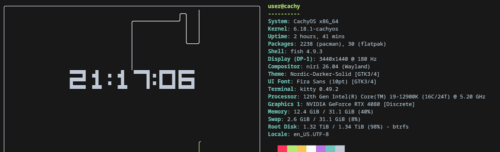
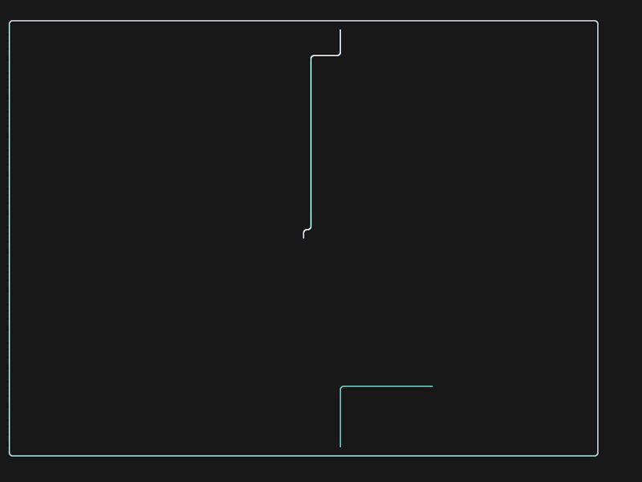
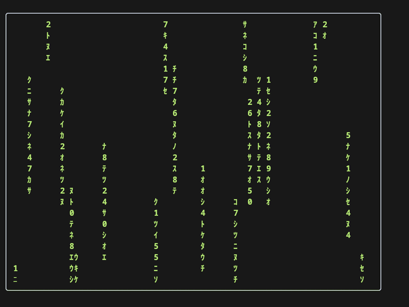
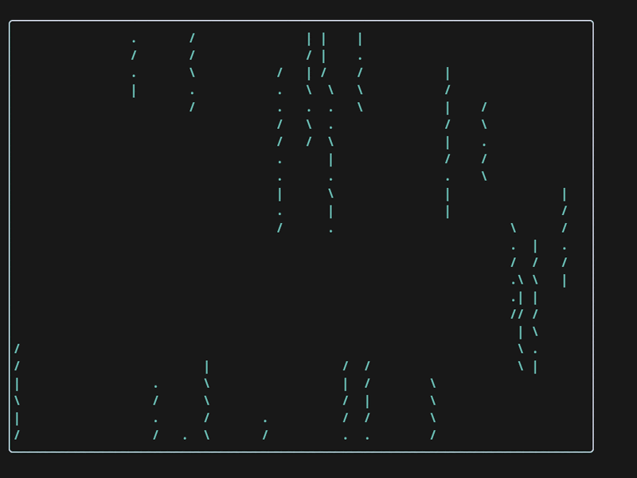
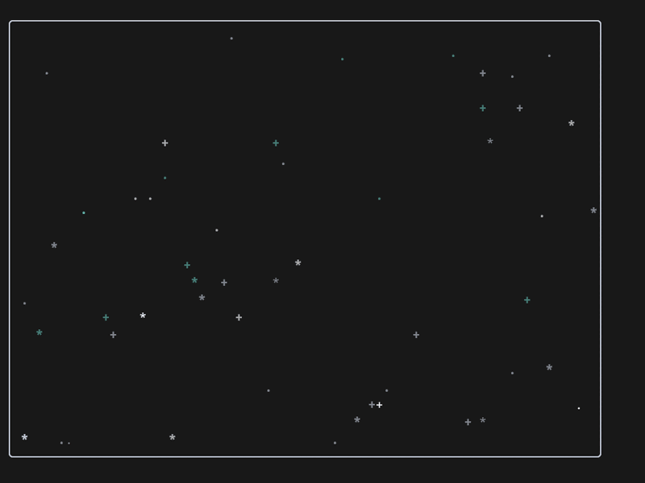
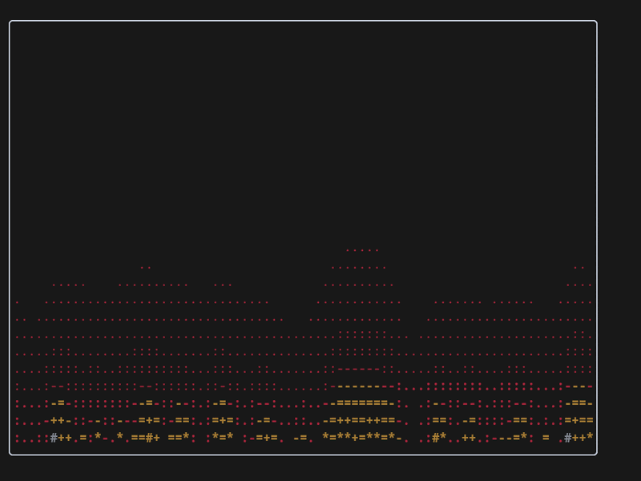
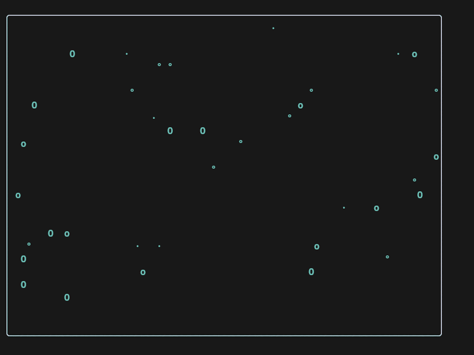
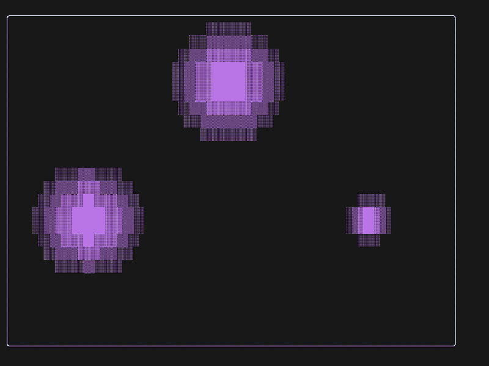
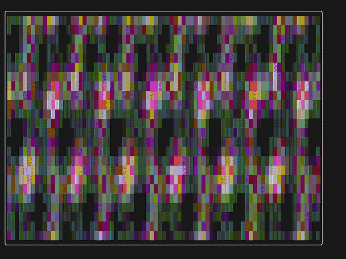
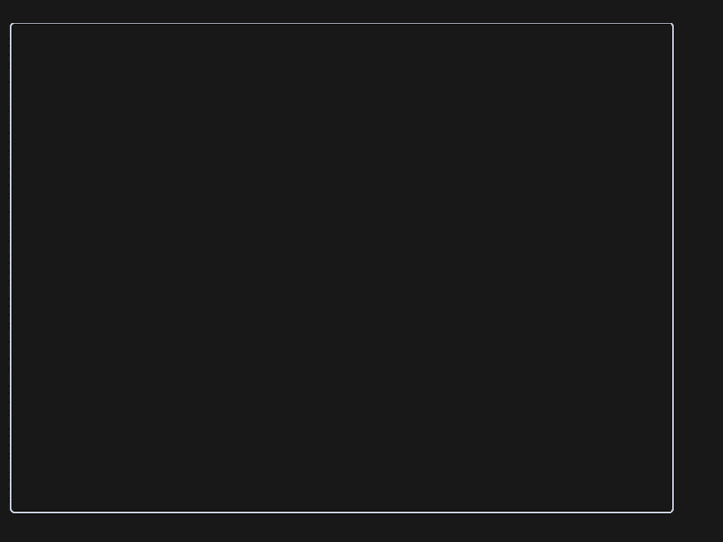

# piperfetch

A small, self-contained fastfetch-style terminal dashboard with live
animations: pipes, Matrix rain, blue rain, stars, fire, bubbles, orbs, or plasma.



The dashboard sits at the top until you run a command. That means:

- the prompt is available immediately;
- typing works normally;
- the pipes keep animating while you are at the prompt;
- when a command starts, the animation stops so its output can scroll the
  dashboard up naturally; a long output pushes it out of sight;
- `clear` / Ctrl-L removes the dashboard and returns to a normal shell.

## Requirements

- **Python 3.11+** (uses the standard-library `tomllib`; no pip packages)
- a Linux/Unix terminal that supports `ESC 7` / `ESC 8` cursor save/restore;
  Kitty is recommended
- **fish, zsh, or bash** for the shell integration (fish is the most tested)
- optional: `niri`, `hyprctl`, `swaymsg`, `wlr-randr`, `xrandr`, `lscpu`,
  `lspci`, `ip`, `gsettings`, `kitty`, `fish` for the corresponding
  information lines. Missing commands simply hide their module.

There are **no third-party Python dependencies** and no build step.

## Installation

```bash
git clone https://github.com/Mr-Sniff/piperfetch.git
cd piperfetch

# optional config
mkdir -p ~/.config/piperfetch
cp config.example.toml ~/.config/piperfetch/config.toml

# fish hooks (stops the animation when a command starts)
mkdir -p ~/.config/fish/conf.d
cp fish/piperfetch.fish ~/.config/fish/conf.d/piperfetch.fish
```

Add the Ctrl-L binding to your `fish_user_key_bindings` function:

```fish
bind \cl __piperfetch_clear_screen
```

If your fish greeting runs another fetch, disable it:

```fish
function fish_greeting
end
```

For **zsh**, add this to `~/.zshrc`:

```zsh
source /absolute/path/to/shell/zsh-piperfetch.zsh
```

For **bash**, add this to `~/.bashrc`:

```bash
source /absolute/path/to/shell/bash-piperfetch.sh
```

The bash integration uses a `DEBUG` trap for preexec detection; merge it with
any existing `DEBUG` trap if you already have one.

Then set Kitty to use piperfetch as its shell program:

```conf
shell /absolute/path/to/piperfetch
```

Restart Kitty or open a new window.

## Run it

```bash
./piperfetch                    # dashboard + exec your $SHELL
./piperfetch --config PATH      # use an alternate config file
./piperfetch --demo             # sanitized demo layout for screenshots
./piperfetch --info             # print the information block only
./piperfetch --list-effects     # list available animations
./piperfetch --check-config     # print the effective configuration
./piperfetch --version
```

## Configuration

The fully commented example is in `config.example.toml`. Copy it to
`~/.config/piperfetch/config.toml` and edit it.

```bash
mkdir -p ~/.config/piperfetch
cp config.example.toml ~/.config/piperfetch/config.toml
```

### How the settings combine

- `effect` chooses **one** effect. Only the block for that effect is used;
  settings for other effects are ignored.
- `fps` is the **master animation clock** and applies to every effect.
- Each effect's `*_speed` is a frame divisor:
  `effective steps per second = fps / speed`.
  For example `fps = 38` with `matrix_speed = 2` advances matrix columns about
  19 times per second.
- `matrix_density` is the fraction of columns that participate (`0.0–1.0`);
  `matrix_trail` is the length behind each bright head.
- `stars_speed` controls how often a few stars twinkle; stars stay in place.
- `orb_speed` controls both the expansion cycle and slow drift of the orbs;
  `orb_min_size` / `orb_max_size` are radii in cells.
- `max_width` / `max_height` are **pixel** caps; with `autosize = false`,
  `width` / `height` are character-cell sizes.
- `specs = false` hides the information block; `shell_rows` then controls how
  much room is left below the box.
- `clock` is independent of the effect; the clock is drawn above the effect.

### Key reference

| Key | Values | Notes |
| --- | --- | --- |
| `specs` | `true` / `false` | Show the system info block |
| `autosize` | `true` / `false` | Grow with the terminal |
| `width`, `height` | cells | Used when `autosize = false` |
| `max_width`, `max_height` | pixels (`0` = off) | Cap the box |
| `align` | `left`, `center`, `right` | Horizontal placement |
| `shell_rows` | rows | Space below the box when specs are off |
| `effect` | `pipes`, `matrix`, `rain`, `stars`, `fire`, `bubbles`, `orbs`, `plasma`, `none` | Select one animation |
| `fps` | `1–240` | Master frame rate |
| `pipe_type` | `0–9` | Pipes glyph style |
| `pipe_colors` | `"1,2,3,4,5,6,7"` | ANSI foreground colors 1–7 |
| `matrix_speed`, `rain_speed` | `1–4` | Frame divisor; higher = slower |
| `matrix_density`, `rain_density` | `0.0–1.0` | Fraction of active columns |
| `matrix_trail`, `rain_trail` | `2–40` | Trail length in cells |
| `matrix_color`, `rain_color` | colour name | `green`, `cyan`, etc. |
| `stars_density` | `0–100` | Percentage of stars |
| `stars_speed` | `1–4` | Twinkle interval; higher = calmer |
| `stars_color` | `multi` or colour | Star colour |
| `fire_intensity` | `0–100` | Fuel/heat amount |
| `fire_speed` | `1–4` | Frame divisor |
| `bubble_density` | `0–100` | Percentage of bubbles |
| `bubble_speed` | `1–4` | Rise step |
| `bubble_color` | colour name | Bubble colour |
| `orb_count` | `2–4` | Number of orbs |
| `orb_speed` | `1–4` | Expansion/drift speed |
| `orb_min_size`, `orb_max_size` | cells | Orb radii |
| `orb_color` | `multi` or colour | Orb colour |
| `plasma_speed` | `1–4` | Frame divisor |
| `plasma_scale` | `0.1–5.0` | Wave tightness |
| `clock` | `true` / `false` | Show the clock |
| `clock_size` | `1–3` | 1 text, 2 three-row, 3 five-row |
| `clock_format` | `strftime` | e.g. `%H:%M:%S` |

The box, clock and information block are redrawn when the terminal is resized.
Resizing clears the visible shell area so reflowed dashboard lines cannot leave
artifacts behind.

## Effects

Set `effect` in the config to choose the animation:

<table>
<tr>
<td align="center"><b>pipes</b><br><br><sub>classic pipes screensaver</sub></td>
<td align="center"><b>matrix</b><br><br><sub>green falling glyphs</sub></td>
<td align="center"><b>rain</b><br><br><sub>blue falling drops</sub></td>
</tr>
<tr>
<td align="center"><b>stars</b><br><br><sub>flickering night sky</sub></td>
<td align="center"><b>fire</b><br><br><sub>flames from the bottom</sub></td>
<td align="center"><b>bubbles</b><br><br><sub>bubbles drifting upward</sub></td>
</tr>
<tr>
<td align="center"><b>orbs</b><br><br><sub>breathing lava-lamp orbs</sub></td>
<td align="center"><b>plasma</b><br><br><sub>multicolour plasma waves</sub></td>
<td align="center"><b>none</b><br><br><sub>clock and border only</sub></td>
</tr>
</table>

The previews above show only the effect area; the clock, border and system
information still work with every effect. See the main demo at the top for the
full layout.

**Orbs** uses `orb_count` (2–4), `orb_speed`, `orb_min_size` /
`orb_max_size` (radii in cells), and `orb_color` (a colour name or `multi`).

## Terminals and shells

The dashboard itself only needs a terminal with ANSI cursor movement and
`ESC 7` / `ESC 8` support. It is tested with Kitty and should work in
Alacritty, foot, WezTerm, Konsole, GNOME Terminal, xterm, tmux, and screen.
Pixel-based `max_width` / `max_height` limits depend on the terminal reporting
its pixel size; terminals that do not report it will simply ignore those caps.

Shell support:

- **fish** — `fish/piperfetch.fish`
- **zsh** — `shell/zsh-piperfetch.zsh`
- **bash** — `shell/bash-piperfetch.sh` (uses a `DEBUG` trap)

The shell hooks stop the animation when a command starts so output can scroll
the dashboard away.

## Window managers

The information block adapts to the desktop it can detect:

- niri
- Hyprland
- Sway / i3
- KDE Plasma
- GNOME Shell
- Xfce
- generic Wayland (`wlr-randr`) and X11 (`xrandr`) display detection

Missing tools or unsupported desktops simply omit the display/window-manager
lines; the rest of the dashboard still works.

## Make it the Kitty default

`~/.config/kitty/kitty.conf`:

```conf
shell /absolute/path/to/piperfetch
```

Kitty then starts `piperfetch` as the shell program. `piperfetch` draws the
dashboard, starts the animation, and `exec`s your `$SHELL`.

The fish side needs the integration in `~/.config/fish/config.fish`:

- `fish_greeting` must be empty, since piperfetch already draws the header.
- `fish_preexec` stops the animation when a command starts, so the output can
  scroll the dashboard away.
- `fish_exit` stops the animation.
- a `clear` wrapper (and a Ctrl-L binding) kills the animation and clears the
  screen, so the dashboard disappears like a normal fetch logo.

The hooks are included in `fish/piperfetch.fish`; see Installation above.

### Other terminals

Set the terminal to launch `piperfetch` instead of the shell:

```conf
# Alacritty (~/.config/alacritty/alacritty.toml)
[terminal.shell]
program = "/absolute/path/to/piperfetch"
```

```lua
-- WezTerm (~/.config/wezterm/wezterm.lua)
config.default_prog = { "/absolute/path/to/piperfetch" }
```

```ini
# foot (~/.config/foot/foot.ini)
[main]
shell=/absolute/path/to/piperfetch
```

For Konsole and GNOME Terminal, use a profile's “custom command” setting.
For xterm:

```bash
xterm -e /absolute/path/to/piperfetch
```

The program itself does not require Kitty; Kitty is only the documented
default.

## Layout

- with `specs = true`, the information block is measured first, the pipes box
  gets the same number of rows, and its width is
  `terminal_columns - information_width - 2`;
- with `specs = false`, the box uses the full width and `terminal_rows -
  shell_rows` rows;
- with `autosize = false`, `width` and `height` from the config are used;
- `max_width` and `max_height` cap the box in pixels, and `align` places the
  dashboard left, center or right when it is narrower than the terminal;
- the box has a white type-1 pipe border and the animation uses only colors
  1–7 (no black);
- the clock is centered in the box, bold, and pipe cells underneath it are
  skipped so the time stays readable.

## Files

- `piperfetch` — the whole program (stdlib only)
- `config.example.toml` — fully commented configuration example
- `fish/piperfetch.fish` — fish hooks
- `shell/bash-piperfetch.sh` — bash hooks
- `shell/zsh-piperfetch.zsh` — zsh hooks
- `demo.gif` — full-layout animated demo
- `demos/` — one preview GIF per effect
- `CHANGELOG.md` — release history
- `LICENSE` — MIT
- `README.md` — this file

Runtime state (the animation PID) is kept in
`$XDG_RUNTIME_DIR/piperfetch-<shell-pid>.pid` and is cleaned up automatically.

## Uninstall

Remove the `shell` line from `kitty.conf`, restore a `fish_greeting` if desired,
and delete this directory.

## License

MIT — see [LICENSE](LICENSE).
