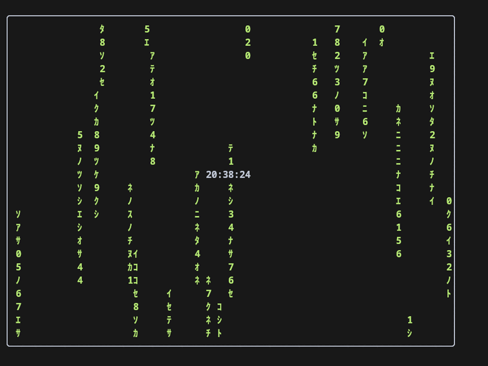
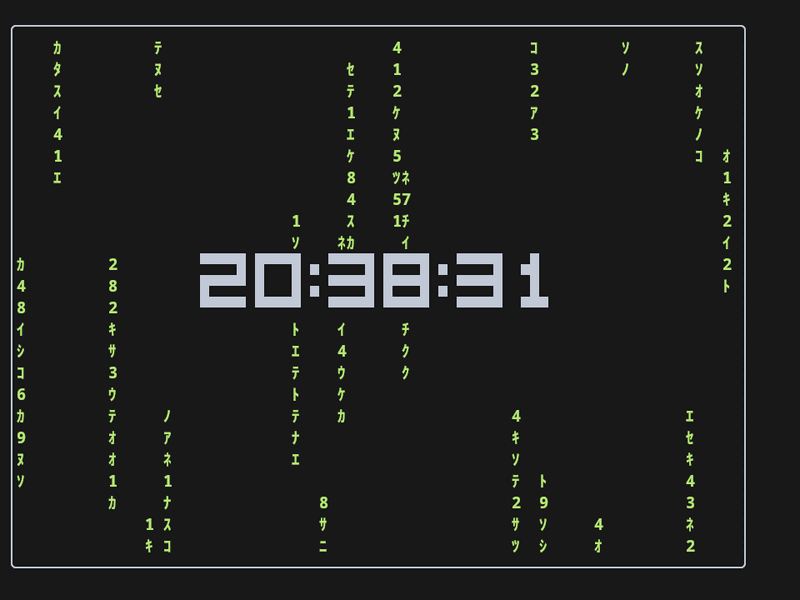
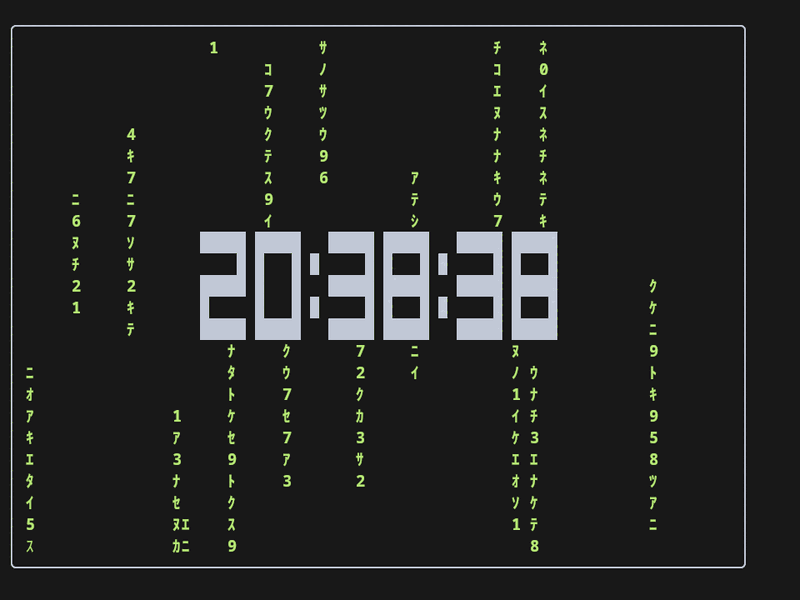

# piperfetch

A small, self-contained fastfetch-style terminal dashboard with live
animations: pipes, Matrix rain, blue rain, stars, fire, bubbles, orbs, or
plasma. The spec sheet has customizable colours, weights, and field names.


**[▶ Watch the 30-second showcase](demos/piperfetch-showcase.mp4)** — effects,
clock sizes, spec-sheet colours, labels, and layout.

## Effects

Set `effect` in the config to choose the animation:

<table>
<tr>
<td align="center"><b>pipes</b><br><br><sub>classic pipes screensaver</sub></td>
<td align="center"><b>matrix</b><br><br><sub>green falling glyphs</sub></td>
<td align="center"><b>rain</b><br><br><sub>blue falling drops</sub></td>
</tr>
<tr>
<td align="center"><b>stars</b><br><br><sub>flickering night sky</sub></td>
<td align="center"><b>fire</b><br><br><sub>flames from the bottom</sub></td>
<td align="center"><b>bubbles</b><br><br><sub>bubbles drifting upward</sub></td>
</tr>
<tr>
<td align="center"><b>orbs</b><br><br><sub>breathing lava-lamp orbs</sub></td>
<td align="center"><b>plasma</b><br><br><sub>multicolour plasma waves</sub></td>
<td align="center"><b>none</b><br><br><sub>clock and border only</sub></td>
</tr>
</table>

The previews above show only the effect area; the clock, border and system
information still work with every effect. See the main demo at the top for the
full layout.

**Orbs** uses `orb_count` (2–4), `orb_speed`, `orb_min_size` /
`orb_max_size` (radii in cells), and `orb_color` (a colour name or `multi`).

### Clock sizes

The clock is independent of the effect and can be one line or a block display:

<table>
<tr>
<td align="center"><b>clock_size = 1</b><br><br><sub>one-line text</sub></td>
<td align="center"><b>clock_size = 2</b><br><br><sub>3-row half-block digits</sub></td>
<td align="center"><b>clock_size = 3</b><br><br><sub>5-row block digits</sub></td>
</tr>
</table>

```toml
clock = true
clock_size = 2          # 1, 2 or 3
clock_format = "%H:%M:%S"
```

Clock sizes work over every effect. Formats must contain only digits, spaces
and `:` for the block clocks; other formats use the one-line clock.

## How it behaves

The dashboard sits at the top of the terminal until it is scrolled away.
That means:

- the prompt is available immediately;
- typing works normally;
- the selected effect keeps animating while you are at the prompt;
- when a command starts, the animation pauses so command output is never
  drawn over;
- when the prompt returns, it resumes unless output has reached the bottom of
  the screen;
- once the prompt is at the bottom row, the dashboard has been scrolled and
  the animation is retired;
- `clear` / Ctrl-L removes the dashboard and returns to a normal shell.

The visibility check uses the terminal's cursor position report (`DSR 6`).
If the terminal does not answer it, the animation is retired at the next
prompt; the dashboard itself still works.

## Requirements

- **Python 3.11+** (uses the standard-library `tomllib`; no pip packages)
- a Linux/Unix terminal that supports `ESC 7` / `ESC 8` cursor save/restore;
  Kitty is recommended
- **fish, zsh, or bash** for the shell integration (fish is the most tested)
- optional: a terminal that answers `DSR 6` (`ESC[6n`) so the animation can
  resume after short commands; without it the animation stops at the next
  prompt
- optional: `niri`, `hyprctl`, `swaymsg`, `wlr-randr`, `xrandr`, `lscpu`,
  `lspci`, `ip`, `gsettings`, `kitty`, `fish` for the corresponding
  information lines. Missing commands simply hide their module.

There are **no third-party Python dependencies** and no build step.

## Installation

```bash
git clone https://github.com/Mr-Sniff/piperfetch.git
cd piperfetch

# optional config
mkdir -p ~/.config/piperfetch
cp config.example.toml ~/.config/piperfetch/config.toml

# fish hooks (pause the animation while a command runs)
mkdir -p ~/.config/fish/conf.d
cp fish/piperfetch.fish ~/.config/fish/conf.d/piperfetch.fish
```

Add the Ctrl-L binding to your `fish_user_key_bindings` function:

```fish
bind \cl __piperfetch_clear_screen
```

If your fish greeting runs another fetch, disable it:

```fish
function fish_greeting
end
```

For **zsh**, add this to `~/.zshrc`:

```zsh
source /absolute/path/to/shell/zsh-piperfetch.zsh
```

For **bash**, add this to `~/.bashrc`:

```bash
source /absolute/path/to/shell/bash-piperfetch.sh
```

The bash integration uses a `DEBUG` trap for preexec detection; merge it with
any existing `DEBUG` trap if you already have one.

Then set Kitty to use piperfetch as its shell program:

```conf
shell /absolute/path/to/piperfetch
```

Restart Kitty or open a new window.

## Run it

```bash
./piperfetch                    # dashboard + exec your $SHELL
./piperfetch --config PATH      # use an alternate config file
./piperfetch --demo             # sanitized demo layout for screenshots
./piperfetch --info             # print the information block only
./piperfetch --list-effects     # list available animations
./piperfetch --check-config     # print the effective configuration
./piperfetch --version
```

## Configuration

The fully commented example is in `config.example.toml`. Copy it to
`~/.config/piperfetch/config.toml` and edit it.

```bash
mkdir -p ~/.config/piperfetch
cp config.example.toml ~/.config/piperfetch/config.toml
```

### How the settings combine

- `effect` chooses **one** effect. Only the block for that effect is used;
  settings for other effects are ignored.
- `fps` is the **master animation clock** and applies to every effect.
- `matrix_speed`, `rain_speed`, `fire_speed`, and `bubble_speed` are frame
  divisors: `effective steps per second = fps / speed`. Higher = slower.
  For example `fps = 38` with `matrix_speed = 2` advances matrix columns about
  19 times per second.
- `matrix_density` is the fraction of columns that participate (`0.0–1.0`);
  `matrix_trail` is the length behind each bright head.
- `stars_speed` is a twinkle interval; higher = calmer. Stars stay in place.
- `orb_speed` and `plasma_speed` scale their per-frame phase; higher = faster.
  `orb_min_size` / `orb_max_size` are radii in cells.
- `max_width` / `max_height` are **pixel** caps; with `autosize = false`,
  `width` / `height` are character-cell sizes.
- `specs = false` hides the information block; `shell_rows` then controls how
  much room is left below the box.
- `clock` is independent of the effect; the clock is drawn above the effect.

### Spec sheet styling

Colours accept:

- an ANSI name: `black`, `red`, `green`, `yellow`, `blue`, `magenta`,
  `cyan`, `white`, `bright_*`, or `default`
- a hex value: `#RRGGBB`
- a 0–255 terminal colour index
- `caret` — reads the Kitty cursor colour from `~/.config/kitty/kitty.conf`

```toml
title_color = "caret"       # same yellow as the cursor
separator_color = "caret"
key_color = "#6cbeb5"       # field names
value_color = "#b2c8d6"     # field values
border_color = "#ffffff"
clock_color = "#ffffff"
title_bold = true
key_bold = true
value_bold = false

[labels]
os = "System"
kernel = "Kernel"
uptime = "Uptime"
packages = "Packages"
shell = "Shell"
display = "Display"
wm = "Compositor"
theme = "Theme"
font = "UI Font"
cursor = "Cursor"
terminal = "Terminal"
terminal_font = "Terminal Font"
cpu = "Processor"
gpu = "Graphics"
memory = "Memory"
swap = "Swap"
disk = "Root Disk"
ip = "Network"
locale = "Locale"
```

The `[labels]` table can rename any field without touching the code. The
defaults above are chosen to be a little more descriptive than the original
short names (for example `System`, `Processor`, `Graphics`, `Root Disk`, and
`Network`).

### Key reference

Every setting lives in one TOML file. Values outside the ranges below are
ignored, so the default is kept. The file is read once at startup.

#### Layout

| Key | Default | Accepted values | Notes |
| --- | --- | --- | --- |
| `specs` | `true` | `true` / `false` | Show the information block |
| `autosize` | `true` | `true` / `false` | Grow the box with the terminal |
| `width` | `54` | integer ≥ 1 | Box width in cells; used when `autosize = false` |
| `height` | `22` | integer ≥ 1 | Box height in cells; used when `autosize = false` |
| `max_width` | `0` | integer ≥ 0 | Pixel cap; `0` = off; needs terminal pixel size |
| `max_height` | `0` | integer ≥ 0 | Pixel cap; `0` = off; needs terminal pixel size |
| `align` | `"left"` | `"left"`, `"center"`, `"right"` | Horizontal placement |
| `shell_rows` | `8` | integer ≥ 0 | Rows kept below the box when specs are off |

#### Spec-sheet styling

Colours accept an ANSI name (`black`, `red`, `green`, `yellow`, `blue`,
`magenta`, `cyan`, `white`, `default`, or any `bright_*` variant), a
`#RRGGBB` value, a terminal colour index from `0` to `255`, or `caret`
(reads the Kitty cursor colour; falls back to `#FFDF80`).

| Key | Default | Accepted values | Notes |
| --- | --- | --- | --- |
| `title_color` | `"green"` | colour | Name and rule colour |
| `separator_color` | `"green"` | colour | Underline below the title |
| `key_color` | `"cyan"` | colour | Field names |
| `value_color` | `"default"` | colour | Field values |
| `border_color` | `"white"` | colour | Box border |
| `clock_color` | `"white"` | colour | Clock digits |
| `title_bold` | `true` | `true` / `false` | Bold title and separator |
| `key_bold` | `true` | `true` / `false` | Bold field names |
| `value_bold` | `false` | `true` / `false` | Bold field values |
| `labels` | see below | `[labels]` table | Rename individual fields |

#### Animation

| Key | Default | Accepted values | Notes |
| --- | --- | --- | --- |
| `effect` | `"pipes"` | `"pipes"`, `"matrix"`, `"rain"`, `"stars"`, `"fire"`, `"bubbles"`, `"orbs"`, `"plasma"`, `"none"` | Select exactly one effect |
| `fps` | `38` | integer 1–240 | Master frame rate for every effect |
| `pipe_type` | `1` | integer 0–9 | Pipes glyph set; see below |
| `pipe_colors` | `"1,2,3,4,5,6,7"` | comma string or array of integers 1–7 | ANSI foreground colours; `0` (black) is excluded |

`pipe_type` values: `0` heavy box, `1` rounded, `2` light box, `3` double,
`4` ASCII `+`, `5` slashes, `6` dots, `7` circles, `8` railway, `9` mixed.
Only the selected effect's keys matter.

#### Per-effect settings

| Key | Default | Accepted values | Used by |
| --- | --- | --- | --- |
| `matrix_speed` | `2` | integer 1–4 | matrix; higher = slower |
| `matrix_density` | `0.35` | number 0.0–1.0 | matrix; fraction of active columns |
| `matrix_trail` | `10` | integer 2–40 | matrix; trail length in cells |
| `matrix_color` | `"green"` | effect colour name | matrix |
| `rain_speed` | `2` | integer 1–4 | rain; higher = slower |
| `rain_density` | `0.25` | number 0.0–1.0 | rain; fraction of active columns |
| `rain_trail` | `8` | integer 2–40 | rain; trail length in cells |
| `rain_color` | `"cyan"` | effect colour name | rain |
| `stars_density` | `3` | integer 0–100 | stars; percentage of cells |
| `stars_speed` | `2` | integer 1–4 | stars; higher = calmer |
| `stars_color` | `"multi"` | `"multi"` or an effect colour name | stars |
| `fire_intensity` | `80` | integer 0–100 | fire; fuel/heat amount |
| `fire_speed` | `2` | integer 1–4 | fire; higher = slower |
| `bubble_density` | `2` | integer 0–100 | bubbles; percentage of cells |
| `bubble_speed` | `6` | integer 1–12 | bubbles; higher = slower |
| `bubble_color` | `"cyan"` | effect colour name | bubbles |
| `orb_count` | `3` | integer 2–4 | orbs; evenly spaced |
| `orb_speed` | `1` | integer 1–4 | orbs; higher = faster |
| `orb_min_size` | `4` | integer 1–30 | orbs; radius in cells |
| `orb_max_size` | `10` | integer 2–40 | orbs; radius in cells |
| `orb_color` | `"purple"` | `"multi"` or an effect colour name | orbs |
| `plasma_speed` | `1` | integer 1–4 | plasma; higher = faster |
| `plasma_scale` | `1.0` | number 0.1–5.0 | plasma; higher = tighter waves |

Effect colour names are `green`, `cyan`, `blue`, `purple`, `magenta`, `red`,
`yellow`, and `white`. These keys do not accept hex values; use the named
colours for effects and the full colour syntax for the spec sheet.

#### Clock

| Key | Default | Accepted values | Notes |
| --- | --- | --- | --- |
| `clock` | `false` | `true` / `false` | Show the clock inside the box |
| `clock_size` | `1` | `1`, `2`, `3` | 1 = one line, 2 = three rows, 3 = five rows |
| `clock_format` | `"%H:%M:%S"` | `strftime` string | Block clocks need only digits, spaces and `:`; other formats use the one-line clock |

#### Labels

`[labels]` accepts any of these keys; each value is a string:

| Key | Default | Key | Default |
| --- | --- | --- | --- |
| `os` | `"System"` | `terminal` | `"Terminal"` |
| `kernel` | `"Kernel"` | `terminal_font` | `"Terminal Font"` |
| `uptime` | `"Uptime"` | `cpu` | `"Processor"` |
| `packages` | `"Packages"` | `gpu` | `"Graphics"` |
| `shell` | `"Shell"` | `memory` | `"Memory"` |
| `display` | `"Display"` | `swap` | `"Swap"` |
| `wm` | `"Compositor"` | `disk` | `"Root Disk"` |
| `theme` | `"Theme"` | `ip` | `"Network"` |
| `font` | `"UI Font"` | `locale` | `"Locale"` |
| `cursor` | `"Cursor"` |  |  |

The box, clock and information block are redrawn when the terminal is resized.
Resizing clears the visible shell area so reflowed dashboard lines cannot leave
artifacts behind.

## Terminals and shells

The dashboard itself only needs a terminal with ANSI cursor movement and
`ESC 7` / `ESC 8` support. It is tested with Kitty and should work in
Alacritty, foot, WezTerm, Konsole, GNOME Terminal, xterm, tmux, and screen.
Pixel-based `max_width` / `max_height` limits depend on the terminal reporting
its pixel size; terminals that do not report it will simply ignore those caps.

Shell support:

- **fish** — `fish/piperfetch.fish`
- **zsh** — `shell/zsh-piperfetch.zsh`
- **bash** — `shell/bash-piperfetch.sh` (uses a `DEBUG` trap)

The shell hooks pause the animation while a command runs. When the prompt
returns, they check the cursor row: above the bottom row the dashboard is
still on screen and the animation resumes; at the bottom row it has been
scrolled away and the animation is stopped.

## Window managers

The information block adapts to the desktop it can detect:

- niri
- Hyprland
- Sway / i3
- KDE Plasma
- GNOME Shell
- Xfce
- generic Wayland (`wlr-randr`) and X11 (`xrandr`) display detection

Missing tools or unsupported desktops simply omit the display/window-manager
lines; the rest of the dashboard still works.

## Make it the Kitty default

`~/.config/kitty/kitty.conf`:

```conf
shell /absolute/path/to/piperfetch
```

Kitty then starts `piperfetch` as the shell program. `piperfetch` draws the
dashboard, starts the animation, and `exec`s your `$SHELL`.

The fish side needs the integration in `~/.config/fish/config.fish`:

- `fish_greeting` must be empty, since piperfetch already draws the header.
- `fish_preexec` pauses the animation when a command starts, so output is
  never drawn over.
- the prompt hook resumes it when the dashboard is still visible and retires
  it once output has scrolled it away.
- `fish_exit` stops the animation.
- a `clear` wrapper (and a Ctrl-L binding) kills the animation and clears the
  screen, so the dashboard disappears like a normal fetch logo.

The hooks are included in `fish/piperfetch.fish`; see Installation above.

### Other terminals

Set the terminal to launch `piperfetch` instead of the shell:

```conf
# Alacritty (~/.config/alacritty/alacritty.toml)
[terminal.shell]
program = "/absolute/path/to/piperfetch"
```

```lua
-- WezTerm (~/.config/wezterm/wezterm.lua)
config.default_prog = { "/absolute/path/to/piperfetch" }
```

```ini
# foot (~/.config/foot/foot.ini)
[main]
shell=/absolute/path/to/piperfetch
```

For Konsole and GNOME Terminal, use a profile's “custom command” setting.
For xterm:

```bash
xterm -e /absolute/path/to/piperfetch
```

The program itself does not require Kitty; Kitty is only the documented
default.

## Layout

- with `specs = true`, the information block is measured first, the pipes box
  gets the same number of rows, and its width is
  `terminal_columns - information_width - 2`;
- with `specs = false`, the box uses the full width and `terminal_rows -
  shell_rows` rows;
- with `autosize = false`, `width` and `height` from the config are used;
- `max_width` and `max_height` cap the box in pixels, and `align` places the
  dashboard left, center or right when it is narrower than the terminal;
- the box has a white type-1 pipe border and the animation uses only colors
  1–7 (no black);
- the clock is centered in the box, bold, and pipe cells underneath it are
  skipped so the time stays readable.

## Files

- `piperfetch` — the whole program (stdlib only)
- `config.example.toml` — fully commented configuration example
- `fish/piperfetch.fish` — fish hooks
- `shell/bash-piperfetch.sh` — bash hooks
- `shell/zsh-piperfetch.zsh` — zsh hooks
- `demo.gif` — full-layout animated demo
- `demos/` — one preview GIF per effect
- `demos/clock-size-*.gif` — clock size showcases
- `demos/piperfetch-showcase.mp4` — 30-second feature showcase
- `tests/test_config_keys.py` — config-key regression checks
- `CHANGELOG.md` — release history
- `LICENSE` — MIT
- `README.md` — this file

Runtime state (the animation PID) is kept in
`$XDG_RUNTIME_DIR/piperfetch-<shell-pid>.pid` and is cleaned up automatically.

## Testing

```bash
python3 tests/test_config_keys.py
```

The script checks that every config key changes the layout, style, label, or
effect path it belongs to.

## Uninstall

Remove the `shell` line from `kitty.conf`, restore a `fish_greeting` if desired,
and delete this directory.

## License

MIT — see [LICENSE](LICENSE).
